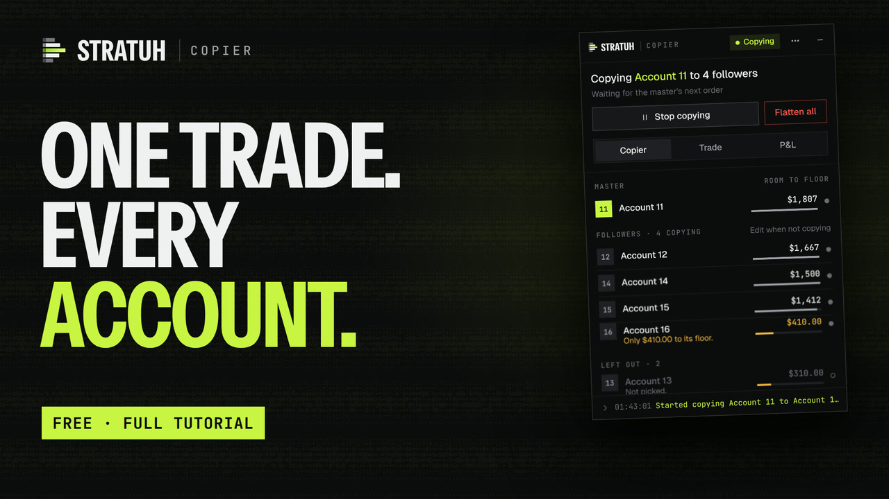
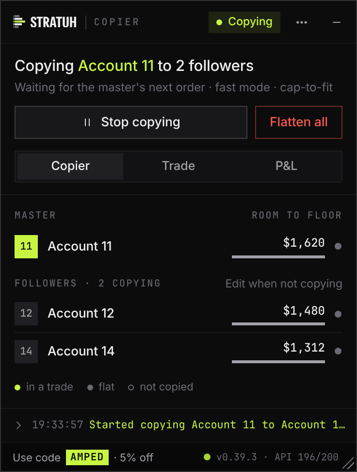
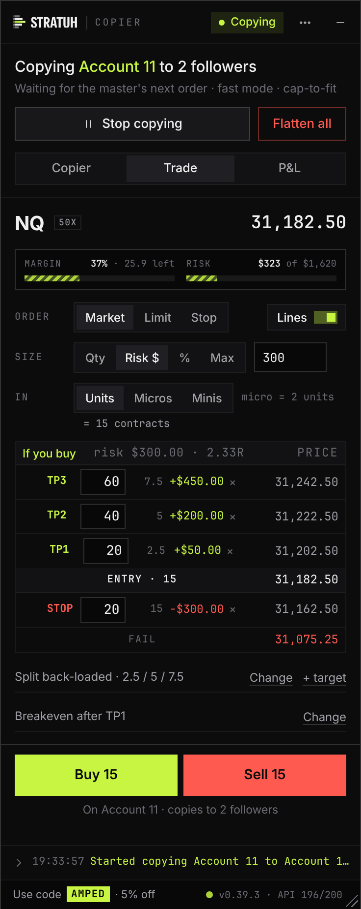
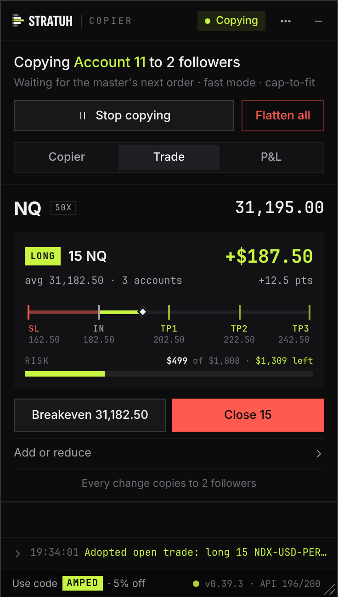
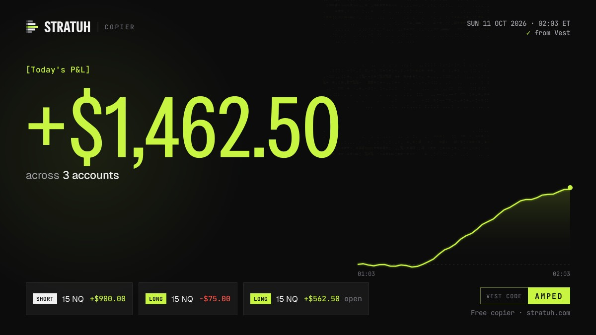
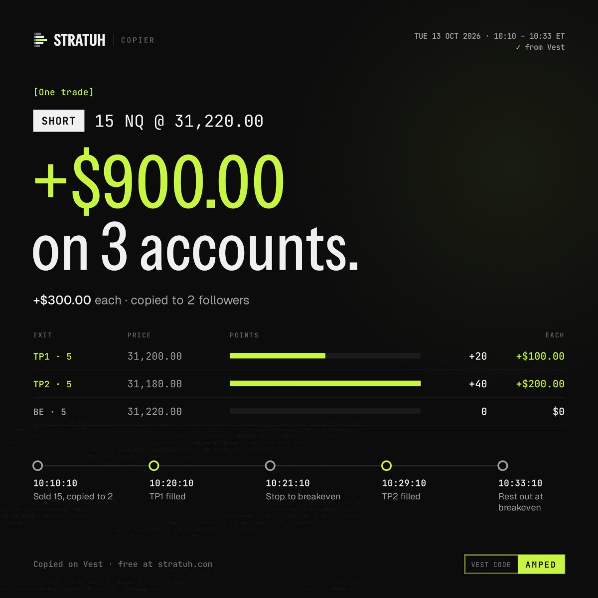

# STRATUH Copier

Trade one Vest account and your other accounts take the same trade, live. It's a Tampermonkey userscript that runs
inside the [Vest Markets](https://next.vestmarkets.com) page, part of STRATUH, my trading tools. It used to be called
Vest Copier: same script, same install link, new look.

New here? Start with the [10-minute tutorial video](https://youtu.be/mFJGsJ0IInY), the [tutorial](https://xamped.github.io/Vest-Copier/tutorial/) or the
[one-page quick start](docs/Vest-Copier-Quick-Start.pdf). Every button is in the [user guide](docs/USER-GUIDE.md).

<table>
  <tr>
    <th>Copier</th><th>Trade</th><th>In a trade</th>
  </tr>
  <tr valign="top">
    <td> Who copies whom, in one sentence.</td>
    <td> Points in, prices out.</td>
    <td> Your bracket on one bar.</td>
  </tr>
</table>

Balances, P&L and fills update live, straight from Vest's own feed, and an account that fails drops out by itself.

Followers size to their own account by default (Cap-to-fit): a smaller account trades a smaller size. Same-size
accounts trade the same size. Switch to strict 1:1 in Edit if you want identical contracts everywhere.

> [!WARNING]
> These are live orders on real accounts. While it's copying, whatever you do on the master happens on every
> follower, mistakes included. Try it with the minimum size before anything else.

## Share your day

Good session? **P&L → Share** turns it into a picture you can paste straight into X, Discord or a group chat: today's
total across your accounts with your best trades, or one trade with every exit and when it happened (any trade from the
last 30 days that made money). You can show percentages instead of dollars, leave the account numbers off and put
your @name on it.

<table>
  <tr>
    <th>Today</th><th>One trade</th>
  </tr>
  <tr valign="top">
    <td> The day, from Vest's own numbers.</td>
    <td> Every exit, to the second.</td>
  </tr>
</table>

## Getting it running

**Use Chrome on a computer.** It's the recommended browser: every release is tested on Chrome before it ships. Edge
and Brave are built on Chrome and behave the same. Firefox works, but isn't tested the same way. Five steps, about five
minutes:

1. **Add Tampermonkey from your browser's store.** It's free; click **Add** on the store page.
   - Chrome or Brave: [Chrome Web Store](https://chromewebstore.google.com/detail/tampermonkey/dhdgffkkebhmkfjojejmpbldmpobfkfo)
   - Edge: [Edge Add-ons](https://microsoftedge.microsoft.com/addons/detail/tampermonkey/iikmkjmpaadaobahmlepeloendndfphd)
   - Firefox: [Firefox Add-ons](https://addons.mozilla.org/firefox/addon/tampermonkey/)

   Get it from the store links above, not from download buttons on other sites (some are ads for other software).
2. **Chrome, Edge or Brave only:** go to `chrome://extensions`, click **Details** under Tampermonkey and switch
   **Allow User Scripts** on. It's off by default, and the copier won't run without it. No such switch? Turn on
   **Developer mode** (top right of the same page) instead. Firefox skips this step.
3. **Install the copier:** open
   **[vest-copier.user.js](https://github.com/xAmped/Vest-Copier/releases/latest/download/vest-copier.user.js)**.
   Tampermonkey shows an install page. Click **Install**.
4. **Open Vest:** log in at [next.vestmarkets.com](https://next.vestmarkets.com). The STRATUH Copier panel opens on
   Vest's chart, on the left. Read the risk notice and accept it.
5. **Pick your accounts and start:** the panel asks you to choose accounts. Pick your lead account as the master and
   tick each account you want copying it, then press **Start copying**. From now on, trade the lead account as usual.
   **Stop copying** stops; positions stay as they are.

> [!TIP]
> Stuck? Watch the [tutorial video](https://youtu.be/mFJGsJ0IInY) or ask in the [Discord](https://discord.gg/Aa69y9KnM3).

## The panel

On top, one sentence says who copies to whom ("Copying Account 11 to 4 followers"), with **Start copying** / **Stop
copying** and a red **Flatten all** under it on every tab. Then three tabs:

| Tab | What's there |
|---|---|
| **Copier** | Your master, the followers and anyone left out, one line each with the room left to the floor. **Edit** picks them. |
| **Trade** | An order ticket in points for the market Vest is showing (details below). |
| **P&L** | Today's P&L (a payout starts an account fresh) and since start, what you keep after each profit split, **Share** (a picture of your day, or of any profitable trade from the last 30 days, to paste anywhere), and **Claim all profit** in one preview and one confirm. |

The **⋯** menu has **Settings** (fast mode, auto-flatten, cap-to-fit, updates, the AMPED code switch),
**Appearance** (text size, what's drawn on the chart, the theme), **Help and rules** (the risk notice, the Discord, the
guides), **Report a problem**, docking and reload.

**On the Trade tab:**

- **Margin and risk bars:** how much of Vest's buying power you're using, and what your stop would cost against the
  room to your floor, before you click.
- **One price ladder:** targets, entry, stop and fail price in a single table, for the side you point at (Buy or Sell).
  The same bracket is drawn on Vest's chart as you set it; drag a line to change it, and **Lines** (next to Market)
  hides or shows it. The stop and targets are optional.
- **Sizing:** contracts, dollars at risk, a % of the max, or the max the account allows. On NQ, ES and RTY, in units,
  **micros** or **minis**, like Vest's own order form.
- **Market, Limit or Stop:** with Limit or Stop, one click on Vest's chart places it. Stop orders (a buy stop over the
  market, a sell stop under it) are kept by the copier, since Vest doesn't have them: they fire while the Vest tab is open.
- **In a trade:** your stop, entry, price and targets on one bar, Breakeven, Close, and scaling in or out: pick 25, 50
  or 100% of the position (or MAX, the most you can add), then Add or Reduce. Your stop and targets stay where they are.

**Flatten all** closes everything on every account at once (no confirmation, and copying keeps running, so it doubles
as a quick exit). At the bottom: the latest activity line (click for the log), then the code and a status dot with
your version and the API budget (click it for Vest's build and the site check).

## Things it won't do

- It won't copy a trade you placed while it wasn't copying, and it won't open a follower into a trade that's already
  running. (If master and followers already hold the same position, starting takes it over.)
- It won't copy an order Vest rejected on the master.
- It won't copy closes Vest makes by itself, such as a stop filling or a drawdown breach on the master. The log tells
  you what Vest did, and a follower still in the trade a few seconds later gets a Flatten / Keep prompt.
- It won't move your stop or targets when you add or reduce. Move them yourself on the chart.
- It won't keep a stop order once its Vest tab is closed or reloaded: stop orders live in the tab (the log says when
  one is cancelled). Vest's own orders (market, limit, your stop and targets) stay on Vest either way.
- It won't let you change the master, followers or Cap-to-fit while copying, or start in a second Vest tab while one
  is already copying. Stop first.
- It won't start right after Vest changes its website until its quick read-only check has passed (it runs by itself
  in a few seconds).

## Troubleshooting

| Symptom | Fix |
|---|---|
| No panel on the Vest page | Allow User Scripts is off (step 2 of Getting it running), or the script is disabled in Tampermonkey. Refresh after fixing. |
| Can't tick a follower | That account is a different size from the master. Pick Cap-to-fit under Sizing in Edit. |
| Start copying refuses | The log names the account and the reason, usually a resting order or an opposite position. Clear it on Vest and start again. |
| "did NOT fill" in the log | Vest accepted the order but didn't execute it, usually not enough margin for that size. The margin bar on the Trade tab shows how much fits. |
| Breakeven stays grey | Price has to be clear of your entry first (Vest refuses a stop the price has already passed). Hover it for the reason. |
| Amber status dot | Vest updated its site and the copier is checking itself. Give it a few seconds. If it says copying is off, send the file from the log's **Download** and use Vest's own panel until an update. |
| Something looks off on Firefox | Try the same thing in Chrome. Every release is tested on Chrome; if it only happens on Firefox, say so in your report. |
| Need a hand | Ask in the [Discord](https://discord.gg/Aa69y9KnM3). |
| Anything else | **⋯ → Report a problem** (or **Get help** next to a problem). It saves a report file and opens a pre-filled [GitHub issue](https://github.com/xAmped/Vest-Copier/issues); drag the file in. The file has sizes, prices and balances but no login data. |

## Updates

New versions show up as a row above the activity line. Click **Install**, confirm in Tampermonkey, switch back to Vest and
the page reloads with the new version (while copying, it asks first: **Reload now**). The [changelog](CHANGELOG.md) lists what each one changed, and the
[roadmap](ROADMAP.md) what's coming next.

If a version turns out to have a problem, I can pause new trades from here while the fix ships. The panel shows
**Paused** with a short note, usually asking you to install the newest version. Stop orders waiting in the tab are
cancelled; trades already open keep copying their exits, and Flatten all always works. Now and then a short note
(Vest maintenance, a heads-up before news) can show under the header too; × dismisses it.

## About the AMPED code

The copier doesn't cost anything. I keep it running in my spare time, so if you were going to buy a Vest evaluation anyway,
code **AMPED** takes 5% off and sends a small commission my way.

It's part of the terms you accept when you first open the panel (and again when the terms change): from then on, the
copier enters AMPED in the discount field of Vest's checkout window whenever it opens, replacing any code that was
there, and logs the change. You can still type another code at checkout, and Settings → Support the copier turns it
off.

## Privacy

The script runs in your browser tab and uses the Vest session you're already logged into. Your orders go to Vest and
nowhere else. Outside Vest it only reads public files: this repository's latest release, to see if there's a newer
version, and a small status file every few minutes (how I can pause new trades if a version has a problem). Only when
you open Share, it also loads three fonts from jsDelivr to draw the picture. Nothing about you or your accounts goes
with any of them.

## Terms

Use it on your own accounts and pass it along unchanged, both free. Selling it, renaming it or releasing an edited
copy is off limits. The full wording lives in [LICENSE](LICENSE), and [DISCLAIMER.md](DISCLAIMER.md) covers the risk
you take on by using it. Independent project by xAmped; Vest Markets has no part in it.
